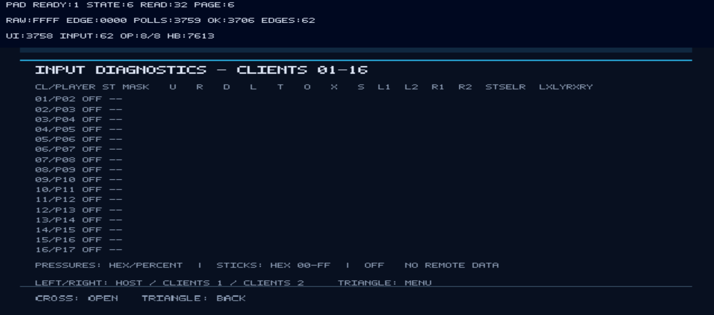
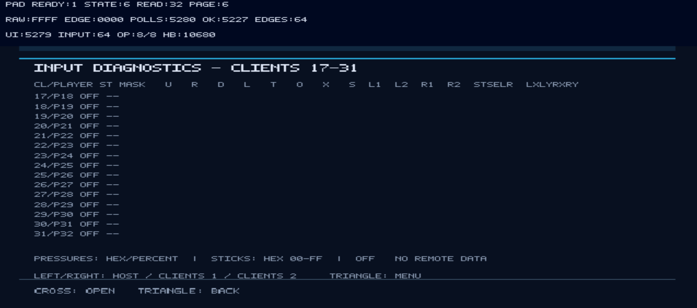

# PS2 Multi-Screen Network Test

Homebrew PlayStation 2 project for exploring multi-screen arrangements and network diagnostics inspired by Gran Turismo 3 i.LINK and Gran Turismo 4 LAN.

## Build and preservation policy

- Stable source lives on `main`; integration on `develop`; experiments on `feature/*`.
- Each build produces separate `.ELF` and `-SOURCE.zip` files, with individual CRC32 checksums.
- Filenames: `PS2-MultiScreen-vVERSION-(DD-MM-YYYY)-[hh-mm-ssAM/PM]-XXXXXXXX.ELF` and `PS2-MultiScreen-vVERSION-(DD-MM-YYYY)-[hh-mm-ssAM/PM]-XXXXXXXX-SOURCE.zip`.
- Timestamp uses Europe/London local time. SHA-256 checksums are also generated.
- GitHub Actions artifacts expire; keep important binaries as GitHub Releases/prereleases.
- BIOS and proprietary files must never be committed.

**Status:** repository initialization; no tested network diagnostic ELF has been published yet.

<h2><strong><ins>Concept:</ins></strong></h2>

<h2><strong><ins>Screenshots:</ins></strong></h2>

Screenshots captured from the PS2 multi-screen network test interface.

### Main menu

### Network adapter

### Diagnostic Counters

### About & Status

### LAN diagnostics — page 1

### LAN diagnostics — page 2

### Input Diagnostics

#### Host

#### Clients Page 1 (01–16)

#### Clients Page 2 (17–31)

### Screen Layout

## Credits, source references and acknowledgements

This is an independent homebrew diagnostic project built with open-source PS2 development tools. Credit is due to the developers who documented PS2 hardware interfaces and made their implementations available for study. The categories below distinguish **adapted implementation techniques**, **libraries/toolchain dependencies**, and **design or research inspiration**; they do not imply that whole applications were copied or that upstream developers endorse this project.

### Source-code techniques adapted for this project

| Project | Contribution and relevance |
| --- | --- |
| [BIOS Drain — F0bes](https://github.com/F0bes/biosdrain) | Reference for low-level IOP loadcore library/export-table lookup and DEV9 EEPROM access. The read-only `iop/macprobe/main.c` adapts the lookup/access approach, including a local export lookup rather than relying on a nonexistent PS2SDK `FindLibrary` API. |
| [PS2Ident — ps2homebrew](https://github.com/ps2homebrew/PS2Ident) | Reference for PS2 hardware identification and reading DEV9 Ethernet identity / EEPROM MAC information. Used alongside BIOS Drain to cross-check the MAC-probe approach. |

The project's `macprobe` is a separate, read-only IOP module with an EE-side SIF RPC client. It does **not** write EEPROM or Mechacon NVRAM. The DEV9 EEPROM MAC and the active NETMAN interface MAC are deliberately reported separately.

### Toolchain and runtime dependencies

| Project | Role |
| --- | --- |
| [PS2DEV / PS2SDK](https://github.com/ps2dev/ps2sdk) | PlayStation 2 EE/IOP development interfaces, module loading, SIF RPC, controller support, DEV9 / NETMAN / SMAP network modules and PS2IP sockets and configuration. The build embeds PS2SDK-supplied IRX modules. |
| [GSKit](https://github.com/ps2dev/gsKit) | Graphics rendering and on-screen diagnostic interface. |
| [PCSX2](https://github.com/PCSX2/pcsx2) | Emulator used for development and testing of DEV9, HDD, Ethernet, networking and controller input. PCSX2 behavior is not necessarily identical to every physical PS2 revision. |

Please refer to the upstream repositories for their authors, contributors, copyright notices and license conditions. Acknowledging these dependencies does not replace compliance with the licenses of any redistributed source or binary components.

### Design inspiration and additional engineering references

| Resource | Inspiration or research context |
| --- | --- |
| **Gran Turismo 3: A-Spec** (Polyphony Digital / Sony) | PS2 i.LINK multi-screen concepts and the six-display screen-numbering arrangement used as a visual reference. |
| **Gran Turismo 4** (Polyphony Digital / Sony) | Ethernet LAN and multi-monitor concepts that inspired networked display arrangements. |
| **Tourist Trophy** (Polyphony Digital / Sony) | Related Polyphony Digital display / multi-screen research reference; not a claim of source-code reuse. |
| [Open PS2 Loader](https://github.com/ps2homebrew/Open-PS2-Loader) | Reference project studied for practical PS2 networking and DEV9/SMAP architecture. |
| [PS2Link](https://github.com/ps2dev/ps2link) | Reference project for homebrew communication with a PS2 over Ethernet. |
| [HDLGameInstaller](https://github.com/ps2homebrew/HDLGameInstaller) | Reference project investigated for PS2 Ethernet / network-adapter initialization and related IOP module interactions. |
| [PCSX2 documentation and source](https://github.com/PCSX2/pcsx2) | Emulator behavior, configuration, and diagnostic cross-checking during development. |

The game titles above are credited **for inspiration only**: no proprietary Gran Turismo or Tourist Trophy source, assets, BIOS files or game code are included or claimed as dependencies.

### How the sources are used

- **Directly adapted technique:** the IOP-side DEV9 EEPROM export lookup and read path, informed by BIOS Drain and PS2Ident. See [`iop/macprobe/main.c`](./iop/macprobe/main.c).
- **Library/API usage:** the EE program uses PS2SDK, PS2IP, NETMAN, SMAP and GSKit interfaces. See [`src/main.c`](./src/main.c) and [`Makefile`](./Makefile).
- **Research and conceptual inspiration:** other PS2 homebrew applications, emulator documentation and commercial multi-screen games helped inform testing and layout choices; listing them does not imply verbatim copied code.

If any upstream attribution or licensing notice is incomplete, please open an issue with the specific file and original source so it can be corrected.
