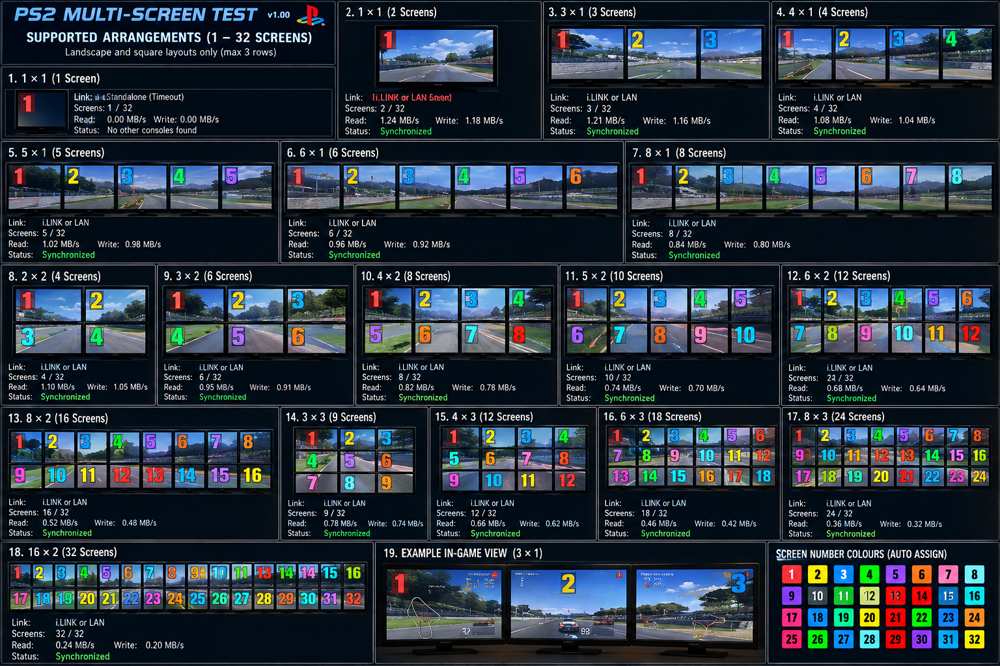
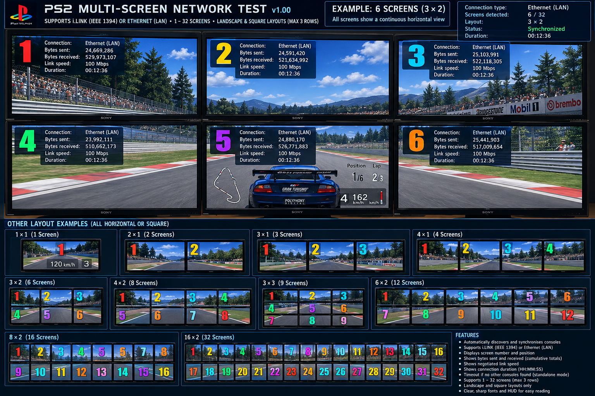
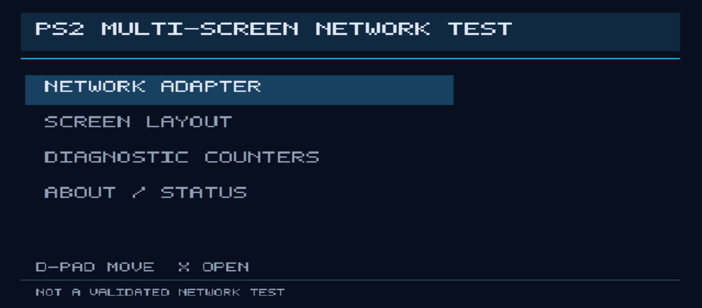
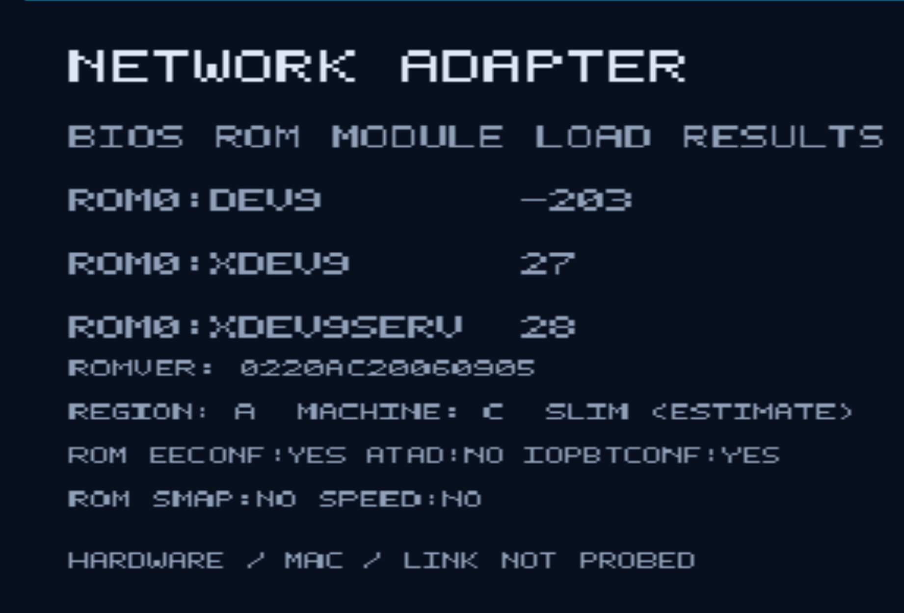
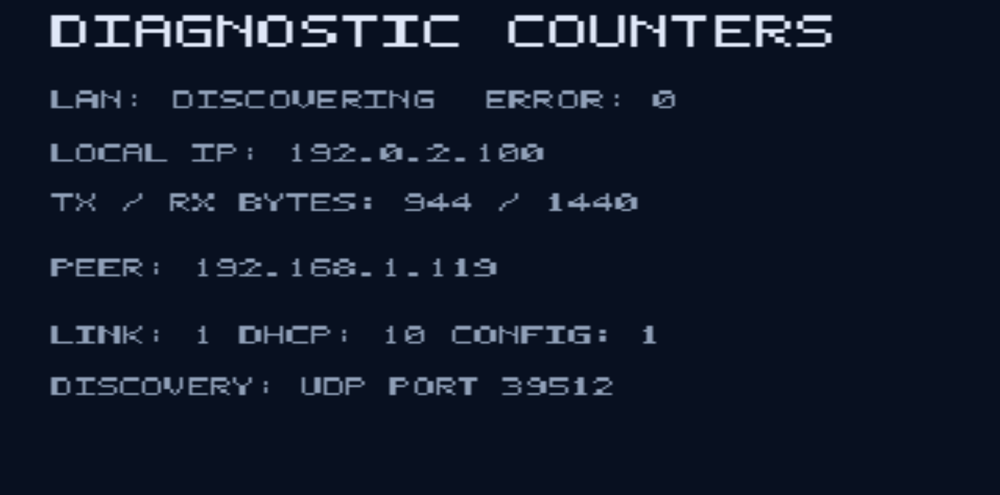
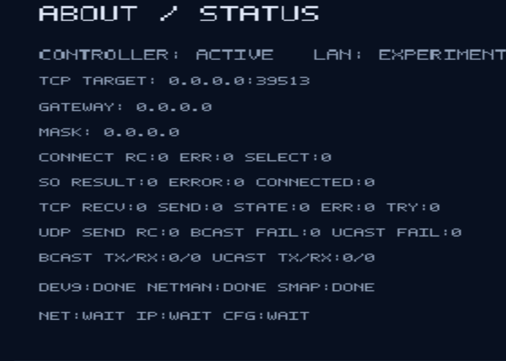
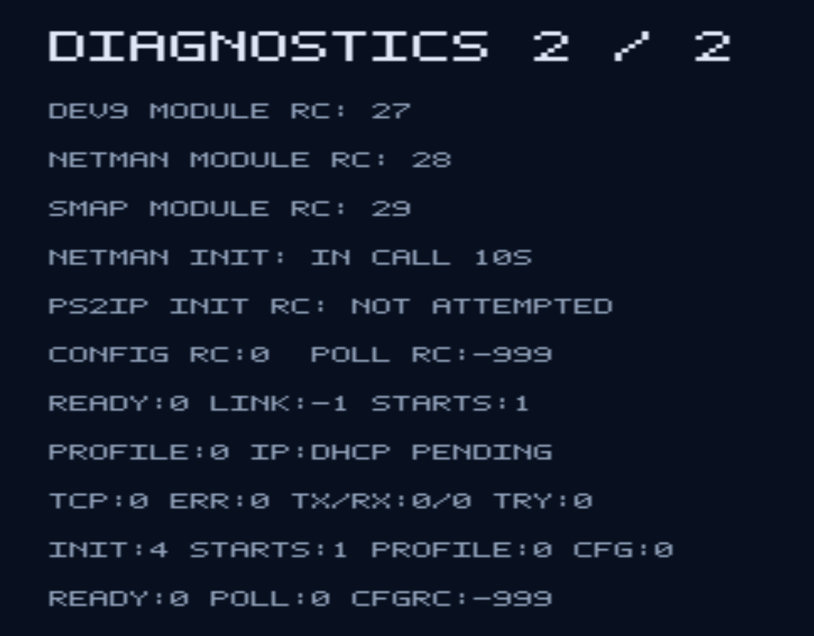
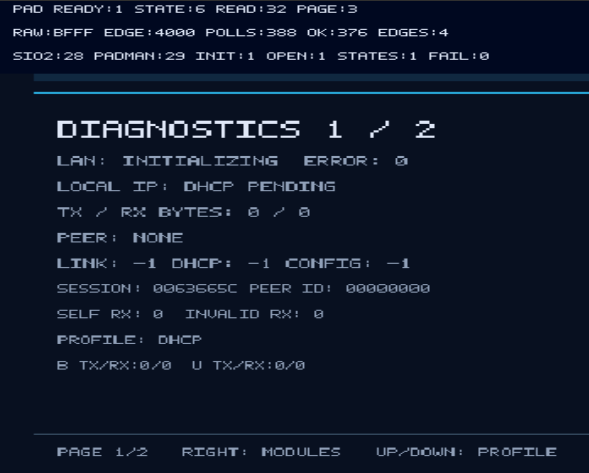
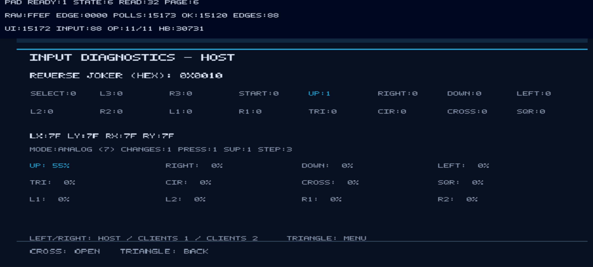
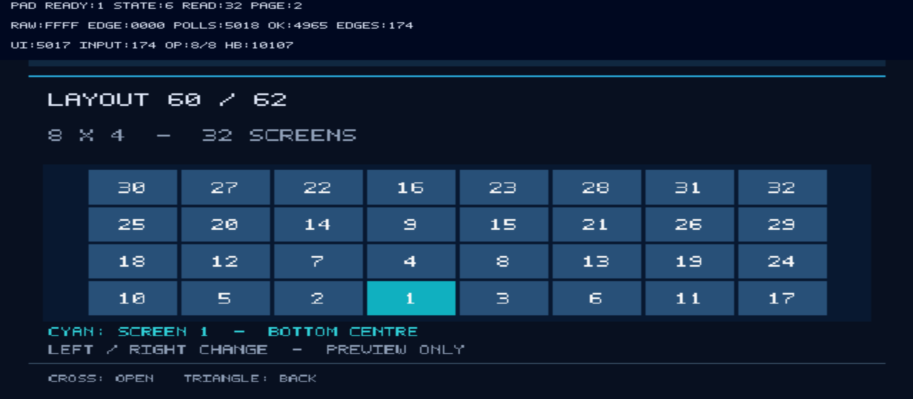

# PS2 Multi-Screen Network Test

Homebrew PlayStation 2 project for exploring multi-screen arrangements and network diagnostics inspired by Gran Turismo 3 i.LINK and Gran Turismo 4 LAN.

## Build and preservation policy

- Stable source lives on `main`; integration on `develop`; experiments on `feature/*`.
- Each build produces separate `.ELF` and `-SOURCE.zip` files, with individual CRC32 checksums.
- Filenames: `PS2-MultiScreen-vVERSION-(DD-MM-YYYY)-[hh-mm-ssAM/PM]-XXXXXXXX.ELF` and `PS2-MultiScreen-vVERSION-(DD-MM-YYYY)-[hh-mm-ssAM/PM]-XXXXXXXX-SOURCE.zip`.
- Timestamp uses Europe/London local time. SHA-256 checksums are also generated.
- GitHub Actions artifacts expire; keep important binaries as GitHub Releases/prereleases.
- BIOS and proprietary files must never be committed.

**Status:** repository initialization; no tested network diagnostic ELF has been published yet.

<h2><strong><ins>Concept:</ins></strong></h2>

<h2><strong><ins>Screenshots:</ins></strong></h2>

Screenshots captured from the PS2 multi-screen network test interface.

### Main menu

### Network adapter

### Diagnostics and counters

### About and status

### LAN diagnostics — page 1

### LAN diagnostics — page 2

### Input Diagnostics layout preview

### Input Diagnostics layout preview

